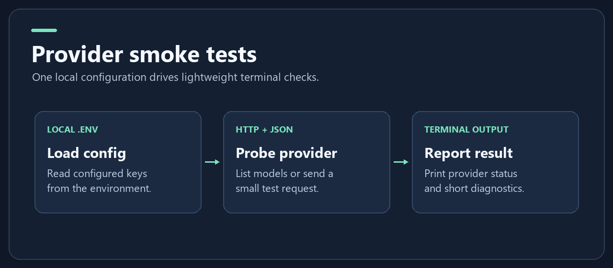

# Multi API Test

Two small command-line utilities for checking AI provider credentials and model access.

**Tech stack** · Python · urllib · argparse · JSON · HTTP



## Check provider setup from the terminal

| Script | Purpose |
| --- | --- |
| [`test_keys.py`](test_keys.py) | Send a short smoke-test request to each provider you configure |
| [`test_opencode_zen.py`](test_opencode_zen.py) | Inspect the Zen model list and optionally send a small test message |

Both scripts use the Python standard library. Copy [`.env.example`](.env.example) to `.env` or export your provider credentials in your shell. Configure only the providers you want to check. Live requests use the credentials you supply and can consume provider quota.

```bash
python test_opencode_zen.py --help
python test_opencode_zen.py --list-only
python test_keys.py
```

## Tests and verification

Use `python -m py_compile test_keys.py test_opencode_zen.py` to check both scripts without credentials or network requests. Use `--list-only` with your own Zen credentials to verify model discovery without making a chat request.
